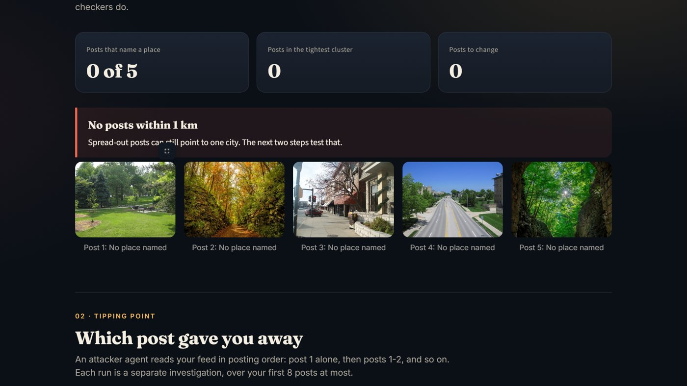
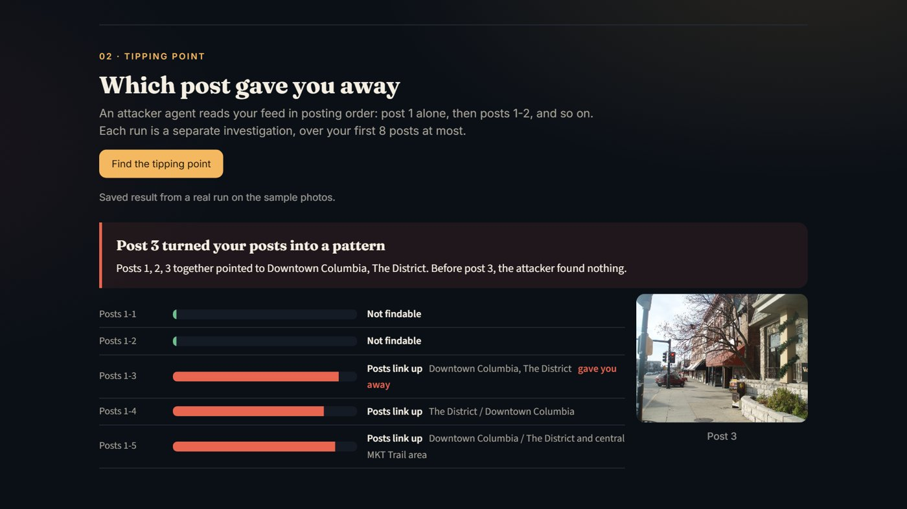
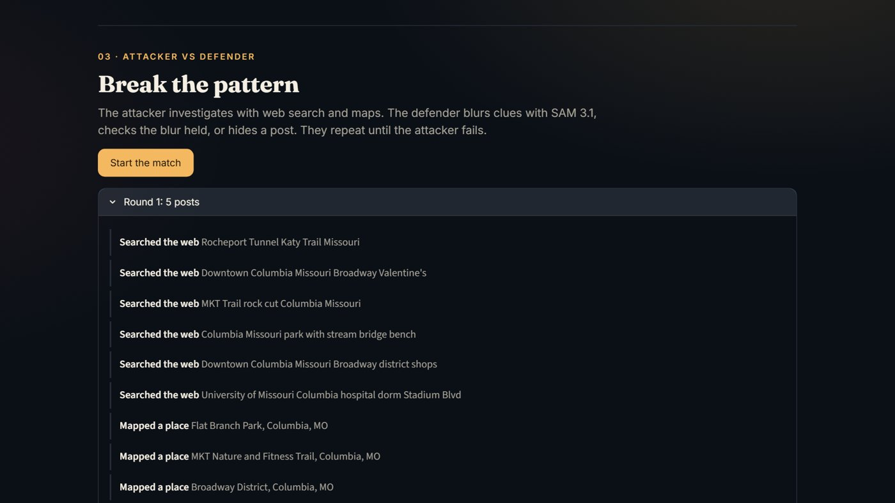
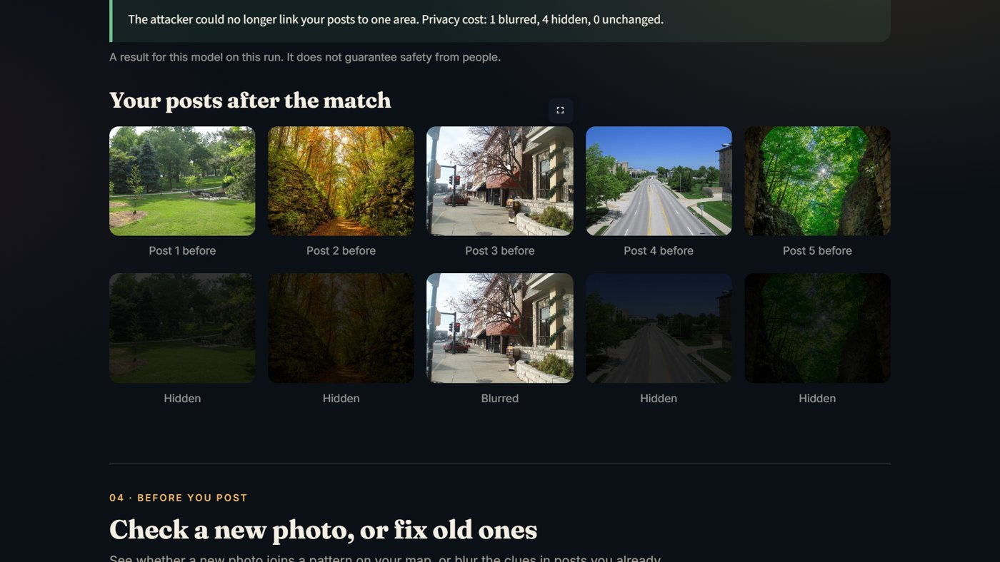
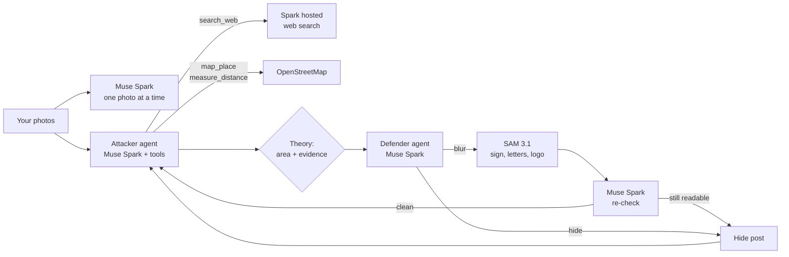

<p align="center"></p>

**Breadcrumbs is a privacy red team for your own photos.** An attacker agent reads your feed the way a stranger would, finds the post where you became findable, and a defender agent breaks the pattern with as little change as it can.

**[Try the live demo](https://waqarsaleem320.github.io/breadcrumbs/)** (runs the saved sample right in your browser; checking your own photos needs the full app, see *Run it*) · **[Watch the 3-minute video](https://youtu.be/BSJ22aaaUpY)**

Built for the Meta Global AI Developer Hackathon 2026 (Indie track, theme: *Build for Your World*) with **Muse Spark** and **SAM 3.1** from the Meta Model API.

---

## The problem in one picture

Photo checkers look at one photo at a time. A stranger looks at all of them.



The sample feed is five public photos: a park, a rail-trail, a downtown street, a campus road and a trail tunnel. Checked one at a time, **none of them names a place.** By the usual standard, this feed is safe.

## Which post gave you away

The attacker agent reads the feed in posting order: post 1 alone, then posts 1–2, then 1–3, and so on. Each step is a separate investigation, run in parallel.



| Feed | What the attacker concluded |
|---|---|
| Post 1 | Nothing |
| Posts 1–2 | A weak guess at central Columbia (confidence 0.65), under the 0.7 bar, so not counted |
| **Posts 1–3** | **Downtown Columbia, Missouri**, citing posts 1, 2 and 3 together |

That answer is correct. No single post gave it away, and two posts were not enough to be sure. The third made it.

## Attacker vs defender

The two agents take turns until the attacker can no longer link the posts:

1. **Attacker** (Muse Spark with tool calling) looks at the posts, then calls `search_web` (Spark's hosted web search), `map_place` and `measure_distance` (OpenStreetMap), and finishes with `submit_theory`: an area, a confidence score and the posts it relied on.
2. **Defender** (Muse Spark) reads that reasoning and picks the fewest changes: blur a clue, or hide a post.
3. **Blur** uses SAM 3.1 to find every sign, letter and logo, then **asks Muse Spark again** whether the place can still be named. If it can, the blur failed and the post is hidden instead.
4. The attacker starts over with fresh eyes on what is left.





On the sample, the pattern broke in 3 rounds (32 attacker tool calls). In the last round the attacker could still read a small window sign in the blurred post and guessed a different town (Fairfield, IA, confidence 0.65), under the bar, so the defender won. **Privacy cost: 1 post blurred, 4 hidden.** Parks and rock cuts have no sign to blur, so scenery could only be fixed by hiding it. The app reports that cost instead of pretending blur fixes everything.

## How it works



| Meta tool | What it does here |
|---|---|
| Muse Spark, vision | Names the public place a photo shows, with a box around the clue |
| Muse Spark, tool calling | Drives the attacker's investigation, step by step |
| Muse Spark, hosted web search | Looks up signs, businesses and landmarks |
| Muse Spark, as judge | Plans the defense, then verifies every blur |
| SAM 3.1 | Finds every sign, letter and logo to blur, with pixel masks |

## Does it work?

**Place-finding on photos it was never tuned on.** I ran the single-photo check on 40 geotagged, open-licensed Wikimedia Commons photos from Eugene, OR and Burlington, VT. The confidence cut-off was set earlier on a separate set of 60 photos from Columbia MO, Madison WI and Chattanooga TN (`demo/eval_tuning_set.json`); none of the 40 test photos were used for tuning.

| Result | Count |
|---|---|
| Photos | 40 |
| Named a place | 11 |
| Within 1 km of the true spot | 9 |
| Named but not found on the map | 1 |
| More than 25 km off | 1 |
| Model errors | 2 |
| Median error, named photos | 163 m |

Most photos it named were public buildings with signs. Everyday snapshots will score lower on their own, which is exactly why the feed-level attacker matters.

**Honest notes from testing**

- Results change from run to run. The sample shows saved real runs, and the page says so.
- Blur works on signs. Scenery (a park, a trail cut, a street layout) leaks too, and only hiding fixes it.
- A live match takes several minutes; the tipping-point scan takes about two to three.

## Bring your own feed

Three ways in, all on the first screen:

- **Upload photos**, oldest post first.
- **Instagram export**: Accounts Center, then *Download your information*, choose *Content* in JSON. Upload the ZIP; Breadcrumbs reads `posts_*.json` and puts your photos in posting order.
- **Facebook export**: same steps, choose *Posts*.

Signing in to Instagram or Facebook directly would need Meta app review, so Breadcrumbs reads the export you download yourself. The ZIP is read in memory and never unpacked to disk. The 20 most recent posts are kept; the tipping-point scan covers the first 8.

## Check inside Instagram and Facebook

The browser extension brings the check to the moment it matters: when you pick a photo in a post composer.

1. Start the local check service: `python -m breadcrumbs.server` (add `--sample` to try it with the sample feed). It prints a one-time token.
2. In Chrome, open `chrome://extensions`, turn on Developer mode, choose **Load unpacked** and pick the `extension` folder.
3. Open the extension popup, paste the token, and upload your Instagram or Facebook export as your feed.

Now, when you choose a photo on instagram.com or facebook.com, a panel appears within about 40 seconds:

- **"This photo links with posts 1, 2. Together they point to …"**, with the attacker's reasoning, or **"No pattern found"**.
- **Use a blurred version** blurs the clues with SAM 3.1, swaps the blurred file into the composer, and checks it again. If it still links, the panel says so and offers to remove the photo.

The upload-time check is one Muse Spark pass with hosted web search, so it is fast but less thorough than the full match. The service listens on 127.0.0.1 only, needs the token on every request, keeps the feed in memory, and never logs photos. `extension/test/index.html` is a neutral composer page for trying it without a social account: run `python -m http.server 8766` inside `extension/` and open http://localhost:8766/test/index.html.

## Safety by design

- **Your own photos only.** Upload asks you to confirm they are yours. Nothing is stored; photos are sent to the Meta Model API for analysis.
- **Public places, never people.** The prompts forbid identifying a person, a home, a school or a schedule.
- **Model output, not a guarantee.** "Pattern broken" means this model failed on this run. A person who knows the area may still recognize a place.
- **Staged sample.** The demo photos are public photos by different authors, picked so that none names a place alone. Posting order is staged too. See [demo/CREDITS.md](demo/CREDITS.md).

## Related work

- Single-photo geolocation is well studied, e.g. [GEO-Detective](https://arxiv.org/abs/2511.22441v1) and [Doxing via the Lens](https://arxiv.org/abs/2504.19373v1), along with tools such as GeoSpy.
- [Creepy](https://boingboing.net/2011/03/31/app-called-creepy-pi.html/amp) (2011) mapped people from the GPS metadata in their posts.
- Breadcrumbs adds three things I did not find together elsewhere: the feed-level **tipping point**, an **attacker-vs-defender loop**, and defenses that are **verified by the model they are meant to fool**.

## Run it

```bash
python -m venv .venv
.venv\Scripts\activate          # macOS/Linux: source .venv/bin/activate
pip install -r requirements.txt
echo "MODEL_API_KEY=your-meta-model-api-key" > .env          # PowerShell: Set-Content .env "MODEL_API_KEY=..." -Encoding utf8
streamlit run app.py
```

Then click **See it on sample photos**. The sample needs no API key; your own photos do.

The live demo is `index.html`: the same app running in the browser with [stlite](https://github.com/whitphx/stlite), built by `python web/build_page.py`. API calls are switched off there.

Tests: `python tests/test_core.py`

To re-record the sample runs: `spike/save_sample.py`, `spike/save_tipping.py`, `spike/save_match.py`. To re-run the accuracy test: `spike/eval_online.py`.

## Project layout

```
app.py                  Streamlit page
breadcrumbs/
  spark.py              Muse Spark: name the place in one photo
  agents.py             Attacker and defender agents, the match loop
  tipping.py            Tipping-point scan over the feed
  importer.py           Instagram and Facebook export ZIPs, in posting order
  server.py             Local check service for the browser extension
  sam.py                SAM 3.1 boxes and masks, blurring
  geo.py                OpenStreetMap lookups, clusters
  views.py              Tipping point and match views
  theme.py              Page styling
extension/              Browser extension: checks photos in Instagram and Facebook composers
demo/                   Sample photos, saved runs, credits
tests/test_core.py      Unit tests
spike/                  Scripts that record the sample and run the accuracy test
```

## Credits and license

Code: MIT, see [LICENSE](LICENSE). Demo photos keep their own licenses, listed in [demo/CREDITS.md](demo/CREDITS.md). Map data © OpenStreetMap contributors.

Made by Muhammad Waqar Saleem.
